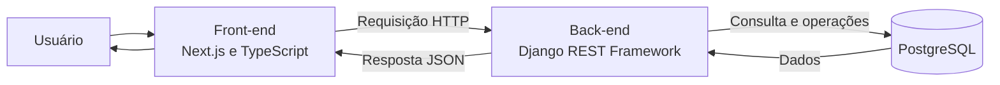

# 2. Arquitetura da Aplicação

## 2.1 Visão da arquitetura

Com base nas tecnologias mencionadas no enunciado do desafio, a arquitetura pode ser representada conceitualmente por três componentes principais:

- **Front-end:** aplicação desenvolvida com Next.js e TypeScript, responsável pela interface e interação com o usuário.
- **Back-end:** aplicação desenvolvida com Python e Django REST Framework, responsável por receber requisições, aplicar validações e regras de negócio e disponibilizar dados por meio de uma API.
- **Banco de dados:** PostgreSQL, utilizado para armazenamento persistente das informações.

> Esta representação é conceitual. A comunicação efetiva entre os componentes e os serviços intermediários precisam ser confirmados na implementação.

## 2.2 Responsabilidades dos componentes

### Front-end

Responsável por:

- Apresentar a interface de consulta de profissionais.
- Capturar filtros e critérios de pesquisa informados pelo usuário.
- Enviar requisições HTTP para a API.
- Interpretar as respostas recebidas.
- Apresentar estados de carregamento, sucesso, ausência de resultados e erro.

### Back-end

Responsável por:

- Disponibilizar os endpoints da API.
- Receber e validar os parâmetros das requisições.
- Aplicar as regras de negócio.
- Consultar e processar os dados necessários.
- Retornar respostas estruturadas em formato JSON.
- Tratar erros de forma consistente.

### Banco de dados

Responsável por:

- Armazenar os dados da aplicação.
- Permitir consultas e operações realizadas pelo Back-end.
- Manter a persistência das informações.

## 2.3 Fluxo conceitual de comunicação

O fluxo de consulta pode ser representado pelas seguintes etapas:

1. O usuário acessa a interface e informa os critérios de pesquisa.
2. O Front-end organiza os parâmetros e envia uma requisição HTTP.
3. O Back-end recebe e valida a requisição.
4. As regras de negócio são aplicadas.
5. O Back-end consulta o banco de dados quando necessário.
6. Os dados são processados e organizados em uma resposta.
7. A API retorna a resposta ao Front-end.
8. O Front-end interpreta o resultado e atualiza a interface.

## 2.4 Diagrama de arquitetura

O diagrama abaixo representa a relação conceitual entre os principais componentes:

## 2.5 Considerações técnicas

A separação entre Front-end, Back-end e banco de dados permite organizar responsabilidades e facilitar a manutenção da aplicação.

O Front-end não deve acessar diretamente o banco de dados. As operações de consulta e manipulação devem ocorrer por meio do Back-end, que centraliza validações, regras de negócio e controles de acesso.

A implementação de autenticação, autorização, monitoramento, cache e demais serviços de infraestrutura deve ser confirmada nas fontes técnicas do projeto antes de ser documentada como comportamento existente.

## 2.6 Pendências de validação

- Confirmar a organização real dos componentes da aplicação.
- Verificar como o Front-end realiza chamadas à API.
- Identificar os endpoints efetivamente implementados.
- Confirmar os mecanismos de autenticação e autorização.
- Verificar a comunicação entre Back-end e PostgreSQL.
- Confirmar a existência de serviços intermediários, como cache ou outros componentes de infraestrutura.